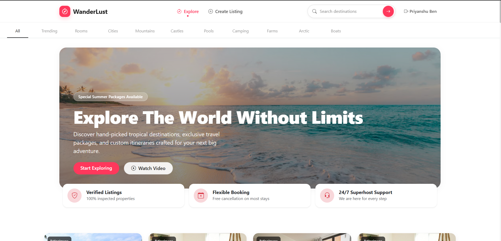
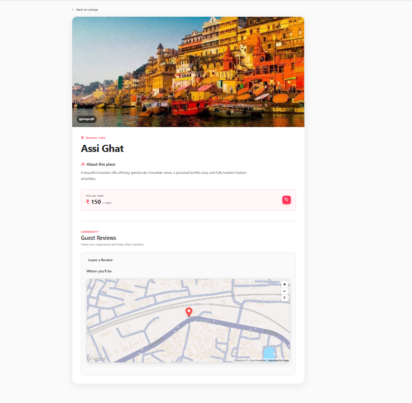
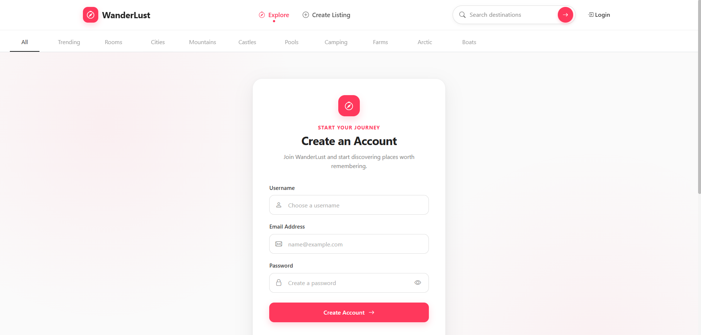

<div align="center">

# 🌍 WanderLust

**A full-stack travel listing platform built to learn and practice real-world backend engineering.**

### 🔗 [Live Demo → wanderlust-kldo.onrender.com](https://wanderlust-kldo.onrender.com/listings)


</div>

---

## 📖 About The Project

**WanderLust** is an Airbnb-inspired travel-stay listing platform where users can discover properties, search and filter listings by category, view them on an interactive map, upload listing images, create and manage listings, authenticate securely, and leave reviews.

The primary purpose of this project is **learning backend engineering by building a real-world full-stack application**.

Instead of learning backend concepts in isolation, WanderLust is being developed incrementally, with each new concept implemented directly into the project.

The project currently covers:

- Database relationships
- Mongoose population
- CRUD operations
- Server-side validation
- Authentication & authorization
- Sessions & cookies
- Flash messages
- Protected routes
- Ownership-based access control
- Review systems
- Centralized error handling
- Reusable middleware
- Modular Express architecture
- EJS layouts and partials
- Search functionality
- Category-based filtering
- Third-party API integration (Mapbox & Cloudinary)
- Geocoding and interactive maps
- Cloud image uploads
- Cloud database hosting with MongoDB Atlas
- Database seeding

---

## 📸 Screenshots

### Home — Category Filters & Search



### Listing Details — Mapbox Map



### Signup



---

## ✨ Features

### ✅ Implemented

#### 🏡 Listings

- **Listings CRUD** — Create, view, update, and delete property listings
- **Listing Ownership** — Each listing is associated with its owner
- **Ownership Authorization** — Only listing owners can edit or delete their listings
- **Listing Details** — Display listing information along with reviews and owner information
- **Search** — Case-insensitive search based on listing titles
- **Category Filters** — Filter listings by 10 categories (trending, rooms, cities, mountains, pools, castles, camping, farms, arctic, boats) through a filter bar (`/listings?category=...`)
- **Price & Rating** — Each listing has a price and a 1–5 rating (defaults to 4.5)
- **Default Image** — Listings without an uploaded image fall back to a default image
- **Image Uploads** — Listing images are uploaded to Cloudinary instead of being stored locally

#### 🗺️ Maps & Geocoding

- **Geocoding** — Listing locations are converted into coordinates using the Mapbox **Geocoding Client**
- **Interactive Maps** — Each listing page displays a Mapbox GL JS map centered on the listing's location
- **Location Marker & Popup** — A custom-colored marker with a popup marks the listing's position
- **Map Controls** — Navigation controls (zoom/rotate) and atmospheric fog effect on the `standard` Mapbox style

#### ☁️ Cloud Services

- **Cloudinary Image Storage** — Uploads handled through `multer` + `multer-storage-cloudinary`, restricted to `png`, `jpg`, and `jpeg`
- **Organized Media** — Images are stored in a dedicated Cloudinary folder (`wanderLust_DEV`)
- **MongoDB Atlas** — The database is hosted in the cloud instead of locally
- **Persistent Sessions** — Sessions are stored in MongoDB Atlas using `connect-mongo`, with encrypted session data
- **Deployment** — The application is deployed on **Render**

#### ⭐ Reviews

- **Add Reviews** — Authenticated users can submit reviews
- **Star Ratings** — Reviews support ratings from 1–5
- **Delete Reviews** — Review authors can delete their own reviews
- **Review Relationships** — Reviews are connected to both listings and users
- **Review Population** — Review authors are populated when displaying a listing

#### 🔐 Authentication & Authorization

- **User Signup & Login** — Authentication using Passport.js
- **Password Hashing** — Passwords handled through `passport-local-mongoose`
- **Sessions** — Persistent authentication sessions using `express-session`
- **HTTP-only Cookies** — Session cookies configured with `httpOnly`
- **Protected Routes** — Authentication middleware protects sensitive operations
- **Listing Authorization** — `isOwner` middleware verifies listing ownership
- **Review Authorization** — `isAuthor` middleware verifies review ownership
- **Login Redirects** — Users can be redirected back to their originally requested route

#### 🛡️ Validation & Error Handling

- **Joi Validation** — Server-side validation for listings and reviews
- **Custom Errors** — `ExpressError` for structured application errors
- **Async Error Handling** — `wrapAsync` eliminates repetitive `try/catch` blocks
- **Centralized Error Handling** — Application-level error middleware
- **Validation Before Database Operations** — Invalid listing/review data is rejected before persistence

#### 💬 User Experience

- **Flash Messages** — Success and error notifications using `connect-flash`
- **Conditional UI** — Ownership-based action buttons
- **Reusable EJS Partials** — Navbar, footer, flash messages, etc.
- **EJS-Mate Layouts** — Reusable page layouts
- **Responsive Interface**
- **Travel Hero Section** — Featured travel content, CTA, statistics, and visual background
- **Search Interface** — Dedicated listing search functionality
- **Category Filter Bar** — Reusable partial for browsing listings by category

#### 🌱 Database

- **MongoDB Database** hosted on **MongoDB Atlas**
- **Mongoose ODM**
- **Database Relationships**
- **`populate()` for referenced documents**
- **Database Seeding** through the `init` script

---

## 🚧 In Progress

- ⚡ **Redis** — Caching
- 🚀 **Production Hardening** — Further production configuration (the app is already live on Render)
- 🔍 **Further Search Improvements** — Combining search with category filters
- 🎨 **UI/UX Improvements**

---

## 🎯 Backend Concepts Covered

| Concept                    | Implementation                                                          |
| -------------------------- | ----------------------------------------------------------------------- |
| **Express Architecture**   | Modular `models/`, `routes/`, `views/`, `utils/`, and `init/` structure |
| **Express Routers**        | Separate listing and review route modules                               |
| **CRUD Operations**        | Listing creation, reading, updating, and deletion                       |
| **Database Relationships** | Listing ↔ Review and User ↔ Listing/Review relationships                |
| **Mongoose Models**        | Listing, Review, and User models                                        |
| **Mongoose References**    | Documents connected through ObjectId references                         |
| **Population**             | `populate()` used for owners and review authors                         |
| **Middleware**             | Authentication, authorization, validation, sessions, and flash messages |
| **Server-side Validation** | Joi schemas for listings and reviews                                    |
| **Authentication**         | Passport.js local authentication                                        |
| **Password Hashing**       | `passport-local-mongoose`                                               |
| **Authorization**          | `isOwner` and `isAuthor` middleware                                     |
| **Protected Routes**       | `isLoggedIn`, `isOwner`, and `isAuthor` middleware                      |
| **Sessions**               | `express-session`                                                       |
| **Cookies**                | HTTP-only session cookies                                               |
| **Flash Messages**         | `connect-flash` with view locals                                        |
| **Error Handling**         | `ExpressError` + `wrapAsync` + centralized middleware                   |
| **Search**                 | MongoDB regex-based case-insensitive title search                       |
| **Filtering**              | Query-string based category filtering (`?category=`)                    |
| **File Uploads**           | `multer` with Cloudinary storage                                        |
| **Third-party APIs**       | Mapbox Geocoding & Mapbox GL JS, Cloudinary                             |
| **Geocoding**              | Converting location text into coordinates with the Geocoding Client     |
| **Cloud Database**         | MongoDB Atlas connection and hosted session store                       |
| **Environment Config**     | `dotenv` in development, environment variables in production            |
| **Templating**             | EJS + EJS-Mate                                                          |
| **Reusable Views**         | Layouts and partials                                                    |
| **Database Seeding**       | Sample data through `init` scripts                                      |
| **Redirect Handling**      | Saving and restoring the originally requested URL                       |

---

## 🛠️ Tech Stack

| Layer                       | Technology              |
| --------------------------- | ----------------------- |
| **Runtime**                 | Node.js                 |
| **Framework**               | Express.js              |
| **Database**                | MongoDB                 |
| **Database Hosting**        | MongoDB Atlas           |
| **ODM**                     | Mongoose                |
| **Authentication**          | Passport.js             |
| **Password Authentication** | passport-local-mongoose |
| **Templating**              | EJS                     |
| **Template Layouts**        | ejs-mate                |
| **Validation**              | Joi                     |
| **Sessions**                | express-session         |
| **Session Store**           | connect-mongo           |
| **Cookies**                 | cookie-parser           |
| **Flash Messages**          | connect-flash           |
| **HTTP Method Support**     | method-override         |
| **File Uploads**            | multer                  |
| **Image Storage**           | Cloudinary, multer-storage-cloudinary |
| **Maps**                    | Mapbox GL JS            |
| **Icons**                   | Bootstrap Icons, Material Icons |
| **Deployment**              | Render                  |
| **Geocoding**               | Mapbox Geocoding Client (`@mapbox/mapbox-sdk`) |
| **Environment Variables**   | dotenv                  |
| **Async Error Handling**    | wrapAsync               |
| **Custom Errors**           | ExpressError            |

---

## 🔄 Application Flow

### Listing Flow

```text
User
 │
 ▼
Browse Listings
 │
 ├── Search ──────────────► MongoDB Atlas
 │
 ├── Category Filter ─────► MongoDB Atlas
 │
 └── Select Listing
          │
          ▼
     Listing Details
          │
          ├── Owner Information
          ├── Images (Cloudinary)
          ├── Map (Mapbox)
          ├── Reviews
          └── Review Authors
```

### Create Listing Flow

```text
Listing Form (with image)
        │
        ▼
 multer + Cloudinary ───► Image URL & filename
        │
        ▼
 Geocoding Client ──────► Coordinates
        │
        ▼
 Joi Validation
        │
        ▼
 Save to MongoDB Atlas
```

### Authentication Flow

```text
Signup / Login
      │
      ▼
Passport.js
      │
      ▼
Session Created
      │
      ▼
HTTP-only Cookie
      │
      ▼
Authenticated Requests
      │
      ├── Protected Listing Operations
      └── Review Operations
```

### Authorization Flow

```text
Request
   │
   ▼
isLoggedIn
   │
   ▼
isOwner / isAuthor
   │
   ├── Authorized ───► Continue
   │
   └── Unauthorized ─► Flash Message / Redirect
```

---

## 🧱 Listing Data Model

| Field         | Type                  | Notes                                              |
| ------------- | --------------------- | -------------------------------------------------- |
| `title`       | String                | Required                                           |
| `description` | String                | Required                                           |
| `image`       | `{ url, filename }`   | Cloudinary image; falls back to a default image    |
| `price`       | Number                | Required, minimum 0 (Joi)                          |
| `location`    | String                | Required, used for geocoding                       |
| `country`     | String                | Required                                           |
| `category`    | String (enum)         | One of the 10 supported categories                 |
| `geometry`    | GeoJSON `Point`       | `[longitude, latitude]` from the Geocoding Client  |
| `rating`      | Number                | 1–5, defaults to 4.5                               |
| `reviews`     | `[ObjectId]`          | References to `Review`                             |
| `owner`       | ObjectId              | Reference to `User`                                |

---

## 🔗 Database Relationships

WanderLust uses MongoDB references to model relationships between users, listings, and reviews.

```text
                ┌──────────────┐
                │     User     │
                └──────┬───────┘
                       │
             ┌─────────┴─────────┐
             ▼                   ▼
       ┌──────────┐        ┌──────────┐
       │ Listing  │        │  Review  │
       └────┬─────┘        └──────────┘
            │
            │
            ▼
        Reviews[]
```

### Relationships

- **User → Listings**
  - A user can own multiple listings.

- **User → Reviews**
  - A user can create multiple reviews.

- **Listing → Reviews**
  - A listing can contain multiple reviews.

- **Review → Author**
  - Each review references the user who created it.

Mongoose `populate()` is used to retrieve related documents when required.

---

## 🔎 Search

WanderLust includes a dedicated search route for finding listings by title.

Search is performed using a **case-insensitive regular expression**, allowing users to search without matching the exact capitalization of a listing title.

```text
/search?q=bali
```

The search results are then rendered through the same listing interface.

---

## 🏷️ Category Filters

Listings can be filtered by category using a reusable filter bar partial.

Each filter sends a `GET` request with the selected category as a query parameter:

```text
/listings?category=<category-name>
```

The listing route reads the query string and returns only the listings that match the selected category.

### Available categories

| Category | | Category | |
| -------- | - | -------- | - |
| `trending` | | `camping` | |
| `rooms` | | `farms` | |
| `cities` | | `arctic` | |
| `mountains` | | `boats` | |
| `pools` | | `castles` | |

Categories are enforced in both the Mongoose schema (`enum`) and the Joi validation schema, so only these values can be saved.

---

## 🗺️ Maps & Geocoding

WanderLust uses **Mapbox** to show where each listing is located.

### How it works

```text
Listing Location (text)
        │
        ▼
Mapbox Geocoding Client ──► [longitude, latitude]
        │
        ▼
Stored with the Listing
        │
        ▼
Mapbox GL JS (client-side) ──► Interactive Map
```

1. When a listing is created, the location text is passed to the **Geocoding Client**, which returns coordinates.
2. The coordinates are saved with the listing.
3. On the listing page (`show.ejs`), the coordinates are extracted from the listing's `geometry` and stored in a `setCenter` variable, along with the Mapbox access token.
4. The client script (`map.js`) uses `setCenter` to center the map and place the marker.
5. **Mapbox GL JS** renders the map with a marker and popup.

Coordinates are stored as a GeoJSON `Point` in the listing's `geometry` field.

### Map features

- Mapbox `standard` style
- Map centered on the listing coordinates (zoom level 16)
- Custom-colored, draggable marker with a welcome popup
- Navigation controls
- Fog / atmosphere effect

---

## ☁️ Image Uploads (Cloudinary)

Listing images are uploaded to **Cloudinary** rather than stored on the server.

```text
Form (multipart/form-data)
        │
        ▼
      multer
        │
        ▼
multer-storage-cloudinary
        │
        ▼
Cloudinary (folder: wanderLust_DEV)
        │
        ▼
Image URL & filename saved in MongoDB
```

- Allowed formats: `png`, `jpg`, `jpeg`
- Cloudinary credentials are loaded from environment variables
- If no image is uploaded, the listing uses a default image URL
- The configuration lives in `cloudConfig.js`

---

## 🗄️ Database Hosting (MongoDB Atlas)

The database runs on **MongoDB Atlas**, MongoDB's cloud service.

- Mongoose connects using the `ATLAS_URL` connection string
- Sessions are stored in Atlas through `connect-mongo`, with the session data encrypted using the app secret
- Session cookies expire after 7 days and are `httpOnly`
- Session store errors are logged for easier debugging

---

## 🧪 Validation

Both listings and reviews are validated on the server using **Joi**.

### Listing Validation

```text
Request
   │
   ▼
ListingSchema
   │
   ├── Valid ──────► Continue
   │
   └── Invalid ────► ExpressError(400)
```

### Review Validation

```text
Request
   │
   ▼
ReviewSchema
   │
   ├── Valid ──────► Create Review
   │
   └── Invalid ────► ExpressError(400)
```

Listing validation covers required text fields, a category restricted to the supported values, a non-negative price, a 1–5 rating, and the optional image and geometry fields. Review validation requires a comment and a 1–5 rating.

This prevents invalid request data from being directly stored in the database.

---

## 🚨 Error Handling

WanderLust uses a centralized error-handling architecture.

```text
Route
 │
 ├── Synchronous Error
 │
 └── Async Error
          │
          ▼
      wrapAsync
          │
          ▼
    ExpressError
          │
          ▼
 Global Error Middleware
          │
          ▼
      error.ejs
```

This keeps route handlers clean while providing consistent error responses throughout the application.

---

## 💬 Flash Messages

The application uses `connect-flash` for temporary success and error messages.

Examples include:

```text
✓ New Listing Created!
✓ Listing Updated!
✓ Listing Deleted!
✓ Review Posted!
✓ Review Deleted!
```

These messages are displayed to the user after actions such as creating, updating, deleting listings, or posting reviews.

---

## 🔐 Authorization

Authorization is implemented at the middleware level.

### Listing Ownership

Listing edit, update, and delete operations use ownership verification:

```text
Authenticated User
        │
        ▼
     isOwner
        │
        ▼
Compare User ID
with Listing Owner ID
        │
   ┌────┴────┐
   ▼         ▼
Allowed    Denied
```

### Review Ownership

Review deletion uses an author-checking middleware to ensure that users can only delete their own reviews.

---

## 🌱 Database Seeding

Sample listing data can be inserted into MongoDB using the `init` directory.

```bash
node init/index.js
```

This provides a convenient way to populate the database with sample listings during development.

---

## ⚙️ Installation & Setup

### 1. Clone the repository

```bash
git clone https://github.com/priyanshu-ben-projects/wanderLust.git
cd wanderLust
```

### 2. Install dependencies

```bash
npm install
```

### 3. Configure environment variables

Create a `.env` file:

```env
# MongoDB Atlas
ATLAS_URL=your_mongodb_atlas_connection_string

# Sessions
SECRET=your_session_secret

# Cloudinary
CLOUD_NAME=your_cloudinary_cloud_name
CLOUD_API_KEY=your_cloudinary_api_key
CLOUD_API_SECRET=your_cloudinary_api_secret

# Mapbox
MAP_TOKEN=your_mapbox_access_token
```

> `dotenv` loads this file automatically when `NODE_ENV` is not `production`. In production, set these variables on your hosting platform instead.

### 4. Start the application

```bash
node app.js
```

For development, you can also use:

```bash
nodemon app.js
```

---

## 🎓 Learning Goals

WanderLust is primarily a **learning-focused backend project**.

The project is being developed incrementally to understand how different backend concepts work together in a real application.

### Current Learning Path

```text
Express
   ↓
CRUD
   ↓
MongoDB
   ↓
Mongoose
   ↓
Database Relationships
   ↓
Validation
   ↓
Error Handling
   ↓
Express Routers
   ↓
Sessions & Cookies
   ↓
Authentication
   ↓
Authorization
   ↓
Reviews
   ↓
Search & Category Filters
   ↓
Cloud Storage (Cloudinary)
   ↓
Maps & Geocoding (Mapbox)
   ↓
Cloud Database (MongoDB Atlas)
   ↓
Redis
   ↓
Production Deployment
```

---

## 🚀 Future Improvements

Planned improvements include:

- [x] Category filters
- [x] Cloudinary image uploads
- [x] Maps using Mapbox and the Geocoding Client
- [x] MongoDB Atlas database hosting
- [ ] Redis caching
- [x] Deployment on Render
- [ ] Production hardening
- [ ] Combined search and category filtering
- [ ] Improved listing discovery
- [ ] Additional UI/UX improvements
- [ ] Further backend performance optimization

---

## 📌 Project Status

**WanderLust is an actively evolving learning project.**

The focus is not simply on completing features, but on understanding the **backend engineering concepts behind them** and implementing those concepts into a progressively more realistic application.

---

## 👨‍💻 Developer

**Priyanshu Ben**

Built as part of my journey toward becoming a **Full Stack Developer**, with a strong focus on backend fundamentals, real-world architecture, and hands-on project development.

---

⭐ If you find the project useful or interesting, consider giving the repository a star!

</div>
